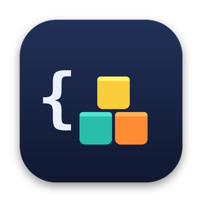
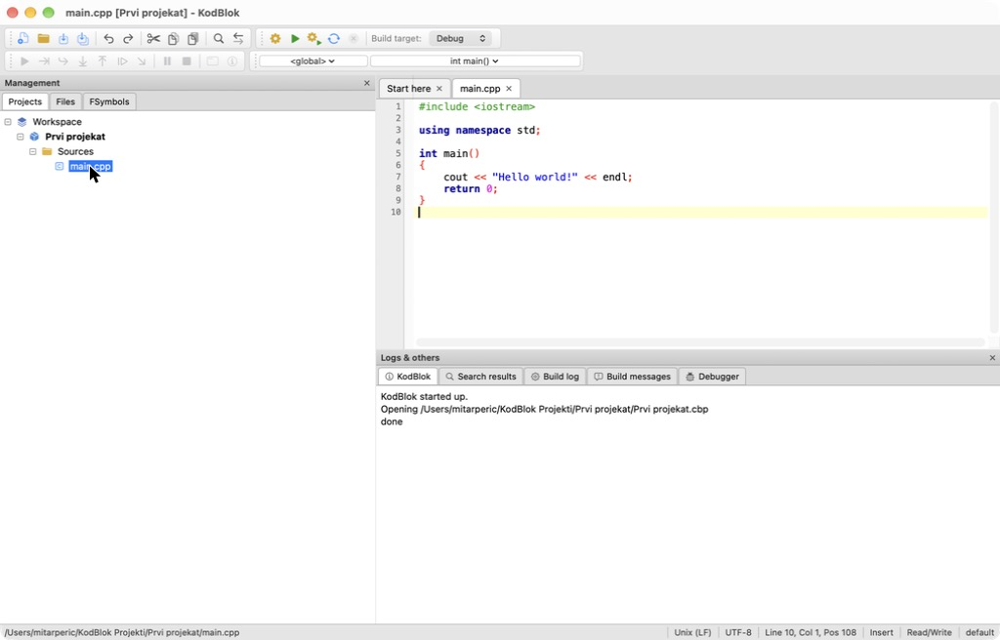
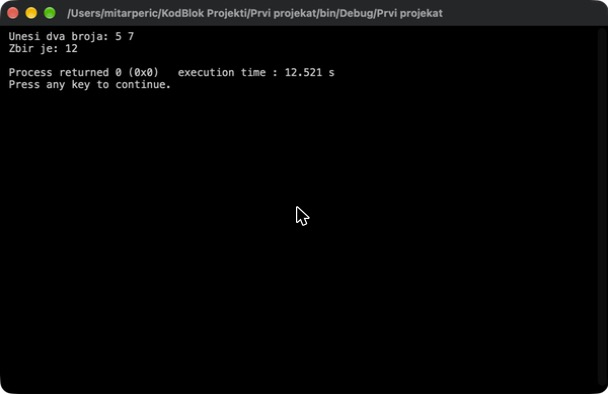
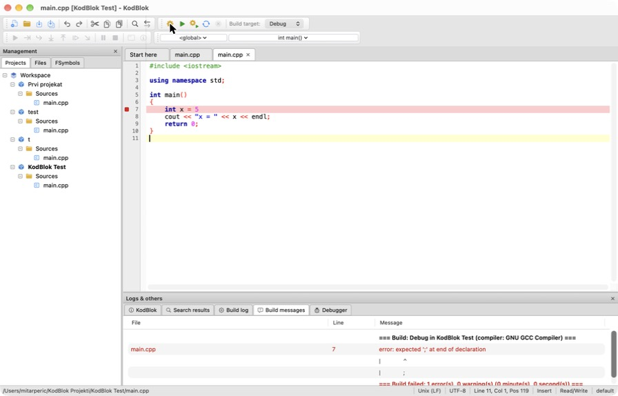
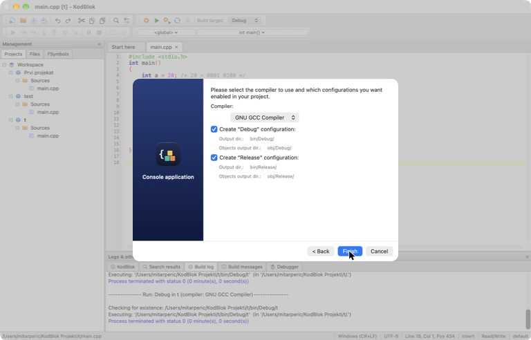
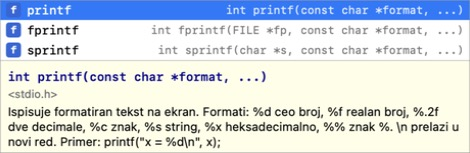
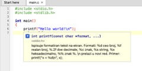

<p align="center">
  
</p>

<h1 align="center">KodBlok</h1>

<p align="center">
  A native C/C++ IDE for macOS (Apple Silicon) inspired by Code::Blocks.<br>
  Same layout, same workflow, same <code>.cbp</code> project files — finally working on M1/M2/M3/M4 Macs.
</p>

<p align="center">
  <a href="#-srpski">🇷🇸 Srpski</a> · <a href="#-english">🇬🇧 English</a>
</p>



---

## 🇬🇧 English

### Why?

Many universities teach C/C++ with **Code::Blocks**, but the official macOS build does not work on modern Macs
(its own download page says the Mac version is currently unusable). KodBlok gives students the same experience on a Mac:
the same panels, the same buttons, the same build log — and it opens and saves real Code::Blocks `.cbp` projects,
so you can move projects between your Mac and the computers at school.

### Features

- **Code::Blocks-style interface** — menus (File, Edit, View, Search, Project, Build, Debug, Tools, Settings),
  two toolbar rows, *Management* panel (Projects / Files / FSymbols), *Logs & others* panel
  (Build log, Build messages, Search results), status bar and a *Start here* page.
- **Real console window** — *Run* opens a separate black console window. Type input directly (`cin`, `scanf`),
  and at the end you get the familiar
  `Process returned 0 (0x0)   execution time : 0.012 s` / `Press any key to continue.`
- **Code::Blocks projects** — `.cbp` files with Debug/Release targets, `bin/Debug`, `obj/Debug`, compiler
  and linker options read from the project. Projects work in both apps.
- **Same build output** — `-------------- Build: Debug in project (compiler: GNU GCC Compiler)---------------`,
  `0 error(s), 0 warning(s)`, *Build messages* table with File / Line / Message; click an error to jump to the line.
- **Editor** — Code::Blocks colour scheme, line numbers, error lines highlighted in red, brace matching,
  auto-closing brackets and quotes, smart indentation, comment/uncomment, find & replace, find in files, go to line.
- **Code completion** — while typing (after 3 letters, like Code::Blocks) a list pops up with library functions,
  **your own functions, variables, structs and macros**, each with its signature and a short explanation of how to use it.
  `↑↓` choose, `Enter`/`Tab` insert, `Esc` close; `Esc` or `⌃Space` opens it manually. After `.` you get
  `string`/`vector` methods and the fields of your structs; after `#include <` a list of headers.
- **Hover tooltips** — rest the mouse on `printf`, `scanf`, `strlen`, `cout`, `sort`… and a tooltip explains what it does.
  For your own functions it shows the signature, file and line, plus the comment written above the function.
- **Claude study assistant** (optional) — a side panel where Claude explains your code, helps find bugs
  (hints first, not full solutions), gives practice tasks and quizzes, and reviews your solutions. It sees the
  file you're editing and the build errors, and can answer based on **your own course materials**
  (PDF/TXT files you put in `~/KodBlok Projekti/Materijali`). Select code → right-click → *Explain selection (Claude)*.
  Connect it either with your **Claude Pro/Max subscription** (via the official Claude Code CLI — no API key,
  no extra cost; KodBlok installs it and you sign in once in the browser) or with an **Anthropic API key**.
- **New project / New file wizards** — Console application → C or C++ → title & folder → Debug/Release.
- **Code::Blocks shortcuts** — `F9` Build and run, `⌘F9` Build, `⌘F10` Run, `⌘F11` Rebuild, `⌘.` Abort.

| Console window | Build messages | New project wizard |
|---|---|---|
|  |  |  |

| Code completion | Hover tooltip |
|---|---|
|  |  |

### Requirements

- A Mac with **Apple Silicon** (M1 or newer) and **macOS 14 Sonoma** or newer
- **Xcode** or the **Command Line Tools** (provides the `gcc`/`g++` compiler).
  If you don't have them, run in Terminal:
  ```sh
  xcode-select --install
  ```

### Installation

1. Download **`KodBlok-2.3.zip`** from the [Releases](../../releases) page.
2. Double-click the zip and drag **KodBlok** into your **Applications** folder.
3. The app is not notarized by Apple, so the first time macOS will say it can't be opened.
   Open **System Settings → Privacy & Security**, scroll down and click **Open Anyway** (only needed once).
   Alternatively, run in Terminal:
   ```sh
   xattr -dr com.apple.quarantine /Applications/KodBlok.app
   ```

Your projects are stored in `~/KodBlok Projekti`.

### Building from source

Open `KodBlok.xcodeproj` in Xcode 15 or newer and press **Run** (⌘R). No dependencies — pure Swift / SwiftUI / AppKit.

### Not done yet

- **Debugger** — the debugger toolbar and menu are there, but not functional yet (planned: breakpoints, step,
  watches and call stack using `lldb`).
- Code folding.
- Intel Mac build.

Contributions and bug reports are welcome — open an [issue](../../issues).

---

## 🇷🇸 Srpski

### Zašto?

Na mnogim fakultetima se C/C++ uči u **Code::Blocks-u**, ali zvanična Mac verzija ne radi na novim Mac-ovima
(i sami autori kažu da je Mac verzija trenutno neupotrebljiva). KodBlok daje isto iskustvo na Mac-u: iste panele,
ista dugmad, isti build log — i otvara i čuva prave Code::Blocks `.cbp` projekte, pa projekte možeš da prenosiš
između svog Mac-a i računara na fakultetu.

### Mogućnosti

- **Izgled kao Code::Blocks** — meniji, dva reda toolbar-a, *Management* (Projects / Files / FSymbols),
  *Logs & others* (Build log, Build messages, Search results), statusna traka i *Start here* stranica.
- **Pravi prozor konzole** — *Run* otvara poseban crni prozor u kome direktno kucaš unos (`cin`, `scanf`),
  a na kraju piše `Process returned 0 (0x0) execution time : ...` i `Press any key to continue.`
- **Code::Blocks projekti** — `.cbp` fajlovi sa Debug/Release, `bin/Debug`, `obj/Debug`.
- **Isti build ispis** — greške u tabeli *Build messages*; klik na grešku vodi na liniju, koja je u editoru crvena.
- **Editor** — Code::Blocks boje, brojevi linija, isticanje zagrada, automatsko zatvaranje zagrada,
  pametno uvlačenje, komentarisanje, pretraga i zamena, pretraga po fajlovima, skok na liniju.
- **Dopunjavanje koda** — dok kucaš (posle 3 slova) iskače lista funkcija iz biblioteka, **tvojih funkcija,
  promenljivih, struktura i makroa**, sa potpisom i objašnjenjem na srpskom kako se koriste. `↑↓` biraš,
  `Enter`/`Tab` ubacuješ, `Esc` zatvara; `Esc` ili `⌃Space` otvara listu ručno. Posle `.` dobiješ metode
  `string`/`vector` i polja tvojih struktura, a posle `#include <` listu biblioteka.
- **Oblačić na prelazak mišem** — zadrži miš na `printf`, `scanf`, `strlen`, `cout`, `sort`… i pojaviće se opis.
  Za tvoje funkcije prikazuje potpis, fajl i liniju, i komentar koji napišeš iznad funkcije.
- **Claude asistent za učenje** (opciono) — panel desno gde ti Claude objašnjava kod, pomaže da nađeš grešku
  (prvo nagoveštaj, ne celo rešenje), zadaje zadatke i kvizove i proverava rešenja. Vidi fajl koji pišeš i
  greške pri kompajliranju, i odgovara po **tvojim predavanjima** (PDF/TXT u `~/KodBlok Projekti/Materijali`).
  Označi kod → desni klik → *Objasni označeno (Claude)*. Povezuješ ga **svojom Claude Pro/Max pretplatom**
  (preko zvaničnog Claude Code programa — bez API ključa i bez dodatnog plaćanja; KodBlok ga instalira, a ti se
  jednom prijaviš u pretraživaču) ili **API ključem**.
- **Wizard za novi projekat i fajl** — Console application → C ili C++ → naziv i folder → Debug/Release.
- **Prečice kao u Code::Blocks-u** — `F9` Build and run, `⌘F9` Build, `⌘F10` Run, `⌘F11` Rebuild, `⌘.` Abort.
  (Na MacBook-u F-tasteri možda traže taster `fn`.)

### Potrebno

- Mac sa **Apple čipom** (M1 ili noviji) i **macOS 14** ili noviji
- **Xcode** ili **Command Line Tools** (kompajler `gcc`/`g++`). Ako fali, u Terminalu: `xcode-select --install`

### Instalacija

1. Preuzmi **`KodBlok-2.3.zip`** sa stranice [Releases](../../releases).
2. Otpakuj ga i prevuci **KodBlok** u **Applications**.
3. Aplikacija nije notarizovana kod Apple-a, pa će je macOS prvi put blokirati:
   **System Settings → Privacy & Security → Open Anyway** (samo jednom).

Projekti se čuvaju u `~/KodBlok Projekti`.

### Šta još ne radi

- **Debugger** (dugmad postoje, ali još ne rade — planiran je preko `lldb`-a)
- Skupljanje blokova koda
- Verzija za Intel Mac-ove

Prijave grešaka i predlozi su dobrodošli — otvori [issue](../../issues).

---

KodBlok is an independent project and is not affiliated with or endorsed by the Code::Blocks team.
Code::Blocks is a trademark of its respective owners.

License: [MIT](LICENSE) © 2026 Mitar Perić
